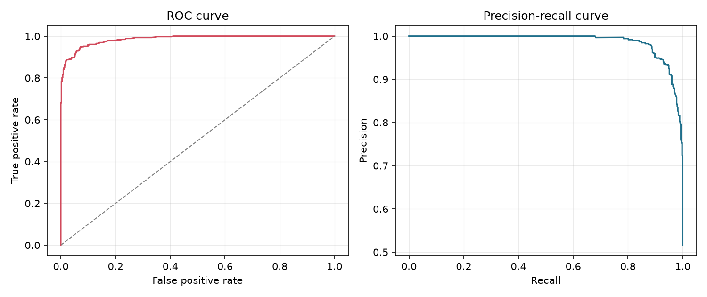
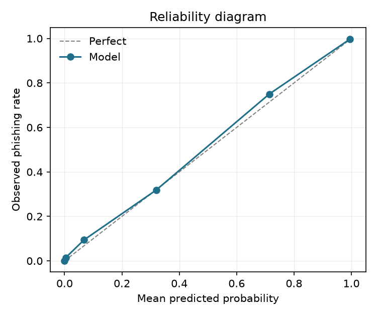
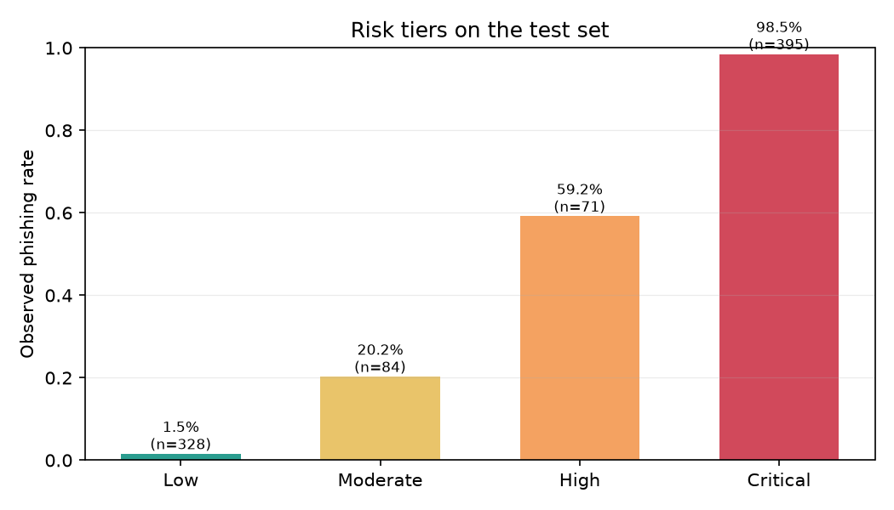
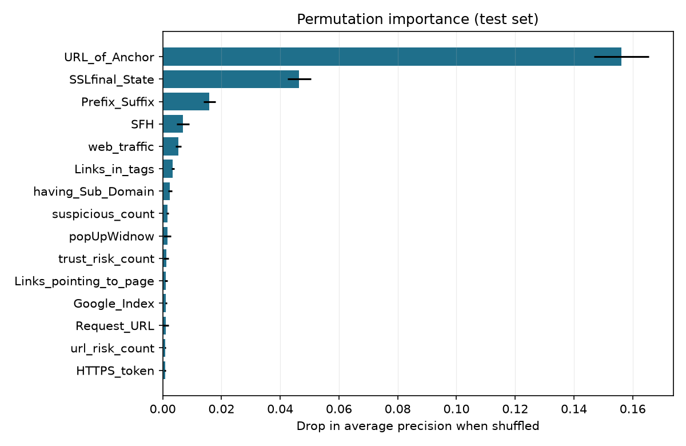

# Phishing Detection Pipeline

**Dataset:** UCI Phishing Websites - 5,849 sites, 3,019 phishing (51.62%).
**Task:** classify a website as phishing from URL, domain, content and trust indicators.
**Operating model:** hist gradient boosting with isotonic calibration and a cost-sensitive threshold.

## 1. Executive summary

- Test-set **ROC-AUC 0.9855**, **PR-AUC 0.9874**, **recall 98.23%** and **precision 83.02%**.
- At threshold **0.14**, **61.05%** of sites are flagged and **8** phishing sites are missed.
- The policy minimises `10 x missed phishing + 1 x false alarm`, with expected cost **97 per 1,000 sites** on validation.
- URL and domain indicators dominate the feature-group importance, while the site risk-count distribution separates most phishing from legitimate sites.

## 2. Dataset and splits

| Split | Sites | Phishing | Phishing rate |
| --- | ---: | ---: | ---: |
| Train | 4,094 | 2,113 | 51.61% |
| Validation | 877 | 453 | 51.65% |
| Test | 878 | 453 | 51.59% |

The split is stratified 70/15/15 with seed 42. Duplicate rows are removed before splitting.

## 3. Method

1. **Cleaning:** convert the UCI target to binary, clip indicators to -1/0/1 and remove duplicates.
2. **Feature engineering:** count phishing-like indicators overall and by URL, domain, content and trust families; add suspicious and safe counts plus a risk ratio.
3. **Preprocessing:** median imputation and standard scaling for all numeric indicators.
4. **Model selection:** 3-fold stratified CV over logistic regression, random forest, extra trees and histogram gradient boosting, ranked by PR-AUC.
5. **Calibration:** isotonic calibration of the winning pipeline.
6. **Thresholding:** validation policy minimises `10 x missed phishing + 1 x false alarm`.

### Model comparison

| model | pr_auc_mean | pr_auc_std | roc_auc_mean | roc_auc_std |
| --- | --- | --- | --- | --- |
| hist_gradient_boosting | 0.9907 | 0.0004 | 0.9895 | 0.0005 |
| extra_trees | 0.9902 | 0.0012 | 0.9889 | 0.0015 |
| random_forest | 0.9884 | 0.0016 | 0.9864 | 0.0017 |
| logistic_regression | 0.9857 | 0.0004 | 0.9838 | 0.0010 |

## 4. Test-set performance

| Metric | Value |
| --- | ---: |
| ROC-AUC | 0.9855 |
| PR-AUC | 0.9874 |
| Accuracy | 88.72% |
| Precision | 83.02% |
| Recall | 98.23% |
| F1 | 0.8999 |
| Brier score | 0.0474 |
| Log loss | 0.1532 |
| Flagged rate | 61.05% |
| Expected cost | 171 |

Confusion matrix: TN 334, FP 91, FN 8, TP 445.

Validation chose **0.14** with expected cost **97 per 1,000**. The test-optimal threshold would be 0.07 with cost 167; it is reported, not used.





## 5. Risk tiers

| tier | sites | phishing | phishing_rate |
| --- | --- | --- | --- |
| Low | 328 | 5 | 1.52% |
| Moderate | 84 | 17 | 20.24% |
| High | 71 | 42 | 59.15% |
| Critical | 395 | 389 | 98.48% |



## 6. Feature importance

Top individual indicators:

| feature | importance_mean | importance_std |
| --- | --- | --- |
| URL_of_Anchor | 0.15614 | 0.00935 |
| SSLfinal_State | 0.04649 | 0.00405 |
| Prefix_Suffix | 0.01594 | 0.00211 |
| SFH | 0.0069 | 0.00223 |
| web_traffic | 0.00535 | 0.0009 |
| Links_in_tags | 0.00347 | 0.00053 |
| having_Sub_Domain | 0.0025 | 0.00061 |
| suspicious_count | 0.0016 | 0.00035 |
| popUpWidnow | 0.00158 | 0.00124 |
| trust_risk_count | 0.00117 | 0.00093 |

Feature-family contribution:

| group | features | importance_mean | importance_std | top_feature |
| --- | --- | --- | --- | --- |
| content | 6 | 0.16840 | 0.01329 | URL_of_Anchor |
| domain | 6 | 0.05076 | 0.00567 | SSLfinal_State |
| url | 6 | 0.01771 | 0.00318 | Prefix_Suffix |
| trust | 12 | 0.01049 | 0.00481 | web_traffic |



## 7. Operational slices

| slice | group | sites | phishing | flag_rate | recall | precision | mean_score |
| --- | --- | --- | --- | --- | --- | --- | --- |
| risk_band | 0-5 | 90 | 11 | 0.1556 | 0.9091 | 0.7143 | 0.0884 |
| risk_band | 11-15 | 234 | 121 | 0.5812 | 0.9917 | 0.8824 | 0.5287 |
| risk_band | 16-20 | 49 | 44 | 0.9388 | 1.0000 | 0.9565 | 0.9047 |
| risk_band | 21-30 | 14 | 14 | 1.0000 | 1.0000 | 1.0000 | 0.9953 |
| risk_band | 6-10 | 491 | 263 | 0.6640 | 0.9772 | 0.7883 | 0.5220 |
| ssl_state | Phishing-like | 306 | 265 | 0.9608 | 1.0000 | 0.9014 | 0.8681 |
| ssl_state | Suspicious | 101 | 101 | 1.0000 | 1.0000 | 1.0000 | 0.9960 |
| ssl_state | Valid | 471 | 87 | 0.2994 | 0.9080 | 0.5603 | 0.1699 |

## 8. Limitations

- UCI features are heuristic indicators, not live URL content or page behaviour.
- The dataset is small and static; modern phishing sites change faster than the indicators.
- Cost weights are illustrative and should come from abuse-team economics.
- The model predicts phishing likelihood, not a legal or safety determination.

## 9. Reproducibility

```bash
python scripts/fetch_data.py
python -m phishing.pipeline
python -m phishing.cli check
streamlit run dashboard/app.py
```

All metrics, figures, predictions and the fitted model are regenerated from `data/raw/phishing_websites.csv`. Checksums are in `artifacts/manifest.json`.

## 10. Next steps

1. Add live URL fetching and HTML feature extraction.
2. Train on recent phishing feeds and measure drift.
3. Add adversarial robustness tests for URL obfuscation.
4. Calibrate the cost model with abuse-team review data.
